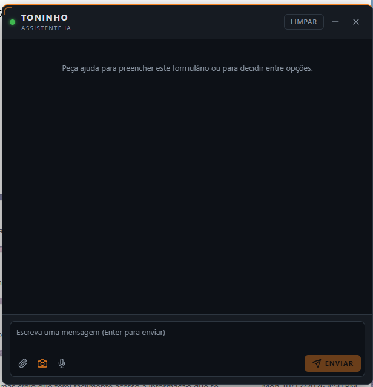

# LLM Form Assistant

Chrome/Edge extension (Manifest V3) that opens a chat widget per tab. The chat sees the page context and its form fields, asks your backend's LLM for help, and lets you apply the field values it proposes.



## Features

- **One chat per tab.** Click the toolbar icon to open the assistant (Toninho) on the current page. Each tab keeps its own conversation, and the conversation survives navigation within that tab.
- **Form filling.** The assistant reads the visible form fields and proposes values. You review each one and click **Aplicar** to apply it, or **Aplicar tudo** to apply them all. Nothing is filled automatically.
- **Decision support.** You can ask the assistant to compare options on the page and recommend one. It uses the page text, any text you have selected, and the form fields.
- **Page screenshot.** When the 📷 toggle is on, a screenshot of the visible area is sent with each message, so vision models can see the page.
- **Attachments.** Use 📎 to attach images, text files (txt, csv, json, md), PDF or Word (.docx). Documents are converted to text in the browser.
- **Voice.** Hold the 🎤 button to dictate in pt-PT. Use **Ouvir** on a reply to have it read aloud.
- **Formatted replies.** Assistant replies render as Markdown, including headings, lists, tables and code.
- **Flexible layout.**
  - Minimize the chat to a round button in the bottom-right corner.
  - Resize it by dragging the top or left edges, or the top-left corner. Double-click the corner to reset the size.
- **Dark tactical theme.** The widget runs inside a Shadow DOM, so page styles do not affect it.
- **Backend.**
  - Works with any OpenAI-compatible endpoint, such as vLLM, Ollama, OpenAI or Azure.
  - Can also use your own backend contract, described in [Custom backend contract](#custom-backend-contract).

## Development

```bash
npm install
npm run dev     # watch build into dist/ with HMR
npm run build   # typecheck + production build into dist/
npm test        # unit tests (form scanning/filling)
npm run zip     # build + package dist/ into release/llm-form-assistant-v<version>.zip
```

With GNU Make, the same commands are available as `make install|dev|build|typecheck|test|check|zip|clean`. Run `make` to list them.

To load the extension, open `chrome://extensions`, enable Developer mode, click **Load unpacked** and select `dist/`.

### Sharing a build

1. Run `npm run zip`.
2. Send the generated file from `release/`.

The recipient extracts it and uses **Load unpacked** on the extracted folder. They then configure the endpoint in **Options**; settings and tokens are not included in the package.

`npm run zip` refuses to overwrite an existing archive. Bump `version` in `package.json` for each release. The extension version is taken from it.

To configure it, open the extension **Options** page. Saving prompts for host permission on the endpoint origin.

| API format | Endpoint URL | Behaviour |
|---|---|---|
| OpenAI-compatible (default) | e.g. `https://llm.example.com/v1/chat/completions` (OpenAI, Azure, vLLM, Ollama, ...) | The extension builds the system prompt from the page context and fields. The model proposes values via a `fill_fields` tool, which requires tool calling (vLLM: `--enable-auto-tool-choice --tool-call-parser <parser>`). `model` is optional. |
| Custom backend | your own API | Uses the contract below. The backend owns the prompt. |

An optional bearer token can be set for either format.

To use it, click the toolbar icon to show or hide the chat on the current tab.

## Architecture

```
src/
  shared/      types, message contracts, settings store
  providers/   ChatProvider interface, OpenAiCompatibleProvider, HttpBackendProvider, SettingsAwareProvider
  background/  service worker: composition root, message router, ChatService, per-tab state
  content/
    page/      FormScanner, FormFiller, PageContextReader (DOM access)
    ui/        React ChatWidget rendered in a closed Shadow DOM
  options/     settings page
```

- **Per-tab state.** Conversation history and open/closed state are kept in `chrome.storage.session` under `tab:<id>`. They survive navigation and service-worker restarts, and are removed when the tab closes.
- **Field ids.** The scanner tags each control with `data-lfa-id`. Ids are only valid for the current page load, so suggestions restored after a navigation are shown read-only.
- **Filling.** Values are set through native prototype setters, followed by `input` and `change` events, so React/Vue/Angular-controlled inputs register the change. Nothing is filled without the user clicking **Apply**.
- **Excluded fields.** Hidden, disabled and read-only fields are never sent to the backend, and neither are password and file inputs.
- **Screenshot.** When the 📷 toggle is on (the default), each message includes a JPEG of the visible tab area, captured with `chrome.tabs.captureVisibleTab` while the widget is hidden. It is sent only with the current turn and never stored. The model must support image input.
- **Attachments (📎).**
  - Images (png, jpg, webp, gif) are sent as `image_url` parts.
  - Text files (txt, csv, json, md), PDF (`pdfjs-dist`) and Word `.docx` (`mammoth`) are converted to text in the browser. Each file is limited to 10 MB, and the extracted text to 50,000 characters.
  - Image data is not persisted, so after the current turn the history keeps only the image name.

## Custom backend contract

`POST <backendUrl>` with `Content-Type: application/json` and, if configured, `Authorization: Bearer <token>`.

Request:

```json
{
  "messages": [
    {
      "role": "user",
      "content": "Fill this with my company data",
      "attachments": [
        { "kind": "text", "name": "company.pdf", "text": "extracted text" },
        { "kind": "image", "name": "logo.png", "dataUrl": "data:image/png;base64,..." }
      ]
    }
  ],
  "screenshot": "data:image/jpeg;base64,... (optional, current turn only)",
  "page": { "url": "https://...", "title": "...", "selectedText": "", "text": "visible page text, max 8000 chars" },
  "fields": [
    {
      "id": "f1", "tag": "input", "type": "text", "name": "company", "label": "Company name",
      "placeholder": "", "value": "", "required": true
    },
    {
      "id": "f2", "tag": "select", "type": "select", "name": "country", "label": "Country",
      "placeholder": "", "value": "", "required": false,
      "options": [{ "value": "pt", "label": "Portugal" }]
    },
    {
      "id": "f3", "tag": "input", "type": "checkbox", "name": "terms", "label": "I accept",
      "placeholder": "", "value": "on", "required": false, "checked": false
    }
  ]
}
```

Response:

```json
{
  "reply": "Text shown in the chat.",
  "actions": [
    { "type": "fill", "fieldId": "f1", "value": "DTx", "reason": "From your profile" },
    { "type": "fill", "fieldId": "f2", "value": "pt" },
    { "type": "fill", "fieldId": "f3", "value": "true" }
  ]
}
```

- `actions` is optional.
- For a `select`, `value` can be either the option value or its label.
- For a checkbox or radio, `value` is `"true"` or `"false"`.

The backend owns the system prompt and the LLM call. A good approach is to expose a `fill_fields` tool to the model and map its tool calls to `actions`.
